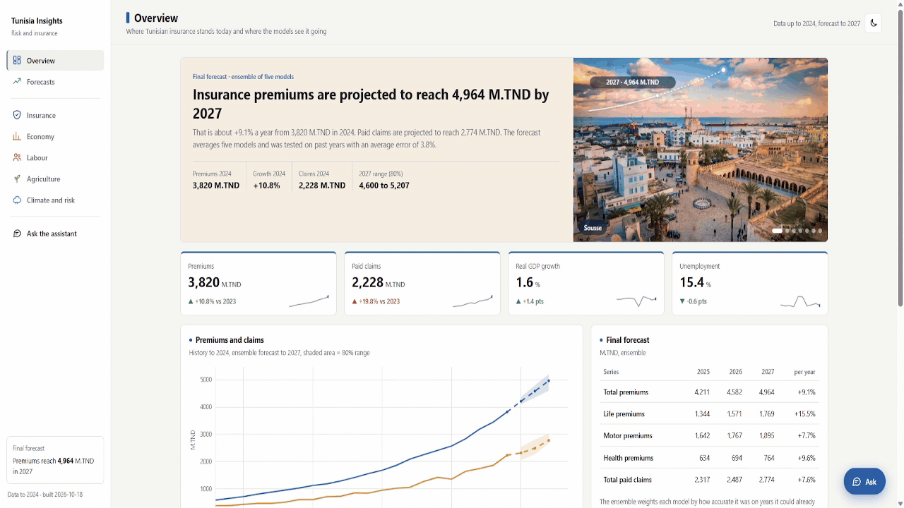
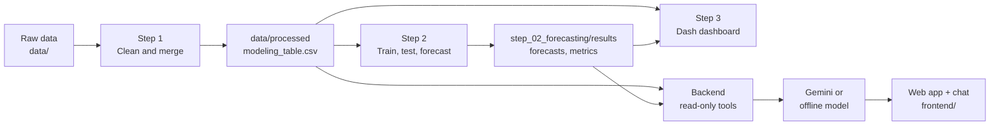

<div align="center">

# Economic Risk and Insurance Insights Generator

**From raw official statistics to honest forecasts of the Tunisian insurance market, with a dashboard and an AI assistant you can ask in plain English.**


<p align="center">
  
</p>

</div>

---

## What this project does

Tunisia publishes its insurance and economic statistics in many different places and formats. This project brings them together and answers three questions:

1. **Where does the market stand?** Premiums and claims by branch, next to the economy, jobs, agriculture and climate.
2. **Where is it going?** Premiums (total, life, motor, health) and paid claims, forecast one to three years ahead, each with an 80% range.
3. **How far can you trust that?** Every model is tested the way it would be used, and the error is reported openly.

You can explore it three ways: a **web app** with a built-in **chat assistant**, a **Python dashboard**, and plain **csv/figure outputs** for each step.

## Highlights

| | |
|---|---|
| **22 years of data** | 2003 to 2024, from the insurance regulator (CGA), the insurers' federation (FTUSA), the World Bank, the central bank (BCT), the statistics institute (INS), FAO, FRED, OECD and Open-Meteo |
| **5 models + 1 ensemble** | ARIMA, Prophet, gradient boosting, random forest and an LSTM, combined into a weighted ensemble |
| **Honest testing** | Each model is refitted year by year from 2012 and asked to forecast the next 1 to 3 years, then compared with what really happened |
| **Average error 3.8%** | Ensemble, over all five series (random forest 3.77%, ensemble 3.79%, practically tied) |
| **Final forecast** | Total premiums reach about **4,964 M.TND in 2027** (80% range 4,600 to 5,207), from 3,820 M.TND in 2024 |
| **Assistant that cites its numbers** | Every figure comes from the project's files through read-only tools, never from the model's memory |

> Forecasts are model estimates, not facts. With only 22 yearly points per series the uncertainty is real; see [Limits](#limits-and-honesty).

## Demo

<p align="center">
  <a href="demo/demo.mp4"><b>▶ Watch the full demo video (about 80 seconds)</b></a>
</p>

## How it works



1. **Step 1, extraction and cleaning** (`step_01_extraction/`). Gaps are filled only when two sources agree, series with a changed base year are chain-linked, and data that cannot be repaired is removed, not guessed. Every change is logged and audited.
2. **Step 2, forecasting** (`step_02_forecasting/`). Five models and an ensemble, tested by backtesting from 2012. Writes forecasts with their 80% range, accuracy tables and plots.
3. **Step 3, dashboard** (`step_03_dashboard/`). Seven tabs: Overview, Insurance, Economy, Labour, Agriculture, Climate and risk, Forecasts.
4. **Backend and web app** (`backend/`, `frontend/`). A small server that gives the chat assistant read-only access to the results, plus a polished single-page site.

## Model accuracy

Every model was tested the way it would be used: from 2012 onwards it was refitted on the years before each date and asked to forecast the next 1 to 3 years, then compared with what really happened. Tables are ranked by MAPE (lower is better). The best value in each column is in **bold**. Premiums and claims are in M.TND.

| Metric | Meaning |
|---|---|
| **MAPE %** | Average miss as a percentage of the true value |
| **MAE** | Average miss in M.TND |
| **RMSE** | Like MAE but large misses count more, in M.TND |
| **CV-RMSE %** | RMSE as a percentage of the average value |
| **R²** | Share of the movement the model explains (1 is perfect) |
| **MASE** | Error compared with repeating last year's value; below 1 beats that simple rule |
| **Bias** | Average signed miss in M.TND; positive means the forecast was too high |
| **80% range hit %** | How often the real value fell inside the model's 80% range |

### All five series

| Rank | Model | MAPE % | MAE | RMSE | CV-RMSE % | R² | MASE | Bias | 80% range hit % |
|---|---|---|---|---|---|---|---|---|---|
| 1 | Random Forest | **3.767** | 48.4 | **57.3** | **4.508** | **0.954** | 0.935 | -10.2 | 76.4 |
| 2 | **Ensemble (final forecast)** | 3.788 | **48.1** | 57.7 | 4.519 | **0.954** | **0.933** | -6.4 | 76.4 |
| 3 | Gradient boosting | 3.831 | 49.0 | 57.6 | 4.559 | 0.950 | 0.957 | -6.3 | 76.4 |
| 4 | LSTM | 4.363 | 56.5 | 69.8 | 5.255 | 0.934 | 1.067 | **-0.5** | 76.4 |
| 5 | ARIMA | 4.371 | 53.2 | 62.7 | 5.187 | 0.936 | 1.083 | -6.2 | 76.4 |
| 6 | Prophet | 4.432 | 56.6 | 68.2 | 5.237 | 0.939 | 1.087 | -7.4 | 76.4 |

## Quick start

### 1. Install

Python 3.10 or newer (developed on 3.14).

```bash
pip install pandas numpy matplotlib scikit-learn statsmodels prophet torch joblib dash plotly
```

The backend and the web app only need `pandas`.

### 2. Get the data

The data files are **not in this repository** (see [`data/README.md`](data/README.md) for every source, its link and what each file holds). Put the raw files in the matching folders under `data/`, then build everything:

```bash
python step_01_extraction/preprocessing/run_all.py      # raw data -> data/processed
python step_02_forecasting/run_all_models.py            # train, test and forecast
```

### 3. Run it

```bash
python backend/server.py            # web app + chat (open the address it prints)
python step_03_dashboard/app.py     # Python dashboard (open the address it prints)
```

Handy extras:

```bash
python frontend/build_single.py                          # one-file version: frontend/dist/tunisia-insights.html
python -m unittest discover -s backend/tests             # backend tests
curl <backend-address>/health                             # is the backend up, and in which mode
```

To restart the backend after changing a `.py` file or `.env`, stop it with `Ctrl+C` and start it again (Python only reads its files at start).

## The assistant

Open the web app and press **Ask**, or use **Ask the assistant** in the left menu for a full-page chat. Each time you open it a new conversation starts, and past conversations are kept in your browser under the clock button.

Try:
- *What will total insurance premiums be in 2027, and how reliable is that forecast?*
- *How big is the motor branch compared with life and health?*
- *Which forecasting model is the most accurate, and by how much?*

**Two engines, one interface**

| Mode | When | What you get |
|---|---|---|
| **Gemini** | `GEMINI_API_KEY` is set in `.env` | Written answers with ratios, shares and growth, built from tool results |
| **Offline** | No key | Templated answers from the same tools, no network at all |

## Tests

```bash
python -m unittest discover -s backend/tests
```

38 checks for the backend (tools, request handling, parsing, security). They use no network and no real key.

## Data sources

CGA, FTUSA, World Bank, BCT, INS, FAOSTAT, FRED, OECD and Open-Meteo. Links, file lists and coverage are in [`data/README.md`](data/README.md).
