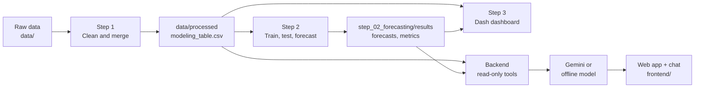

<div align="center">

# Tunisia Risk & Insurance Insights

**From raw official statistics to honest forecasts of the Tunisian insurance market, with a dashboard and an AI assistant you can ask in plain English.**


</div>

---

## What this project does

Tunisia publishes its insurance and economic statistics in many different places and formats. This project brings them together and answers three questions:

1. **Where does the market stand?** Premiums and claims by branch, next to the economy, jobs, agriculture and climate.
2. **Where is it going?** Premiums (total, life, motor, health) and paid claims, forecast one to three years ahead, each with an 80% range.
3. **How far can you trust that?** Every model is tested the way it would be used, and the error is reported openly.

You can explore it three ways: a **web app** with a built-in **chat assistant**, a **Python dashboard**, and plain **csv/figure outputs** for each step.

## Highlights

| | |
|---|---|
| **22 years of data** | 2003 to 2024, from the insurance regulator (CGA), the insurers' federation (FTUSA), the World Bank, the central bank (BCT), the statistics institute (INS), FAO, FRED, OECD and Open-Meteo |
| **5 models + 1 ensemble** | ARIMA, Prophet, gradient boosting, random forest and an LSTM, combined into a weighted ensemble |
| **Honest testing** | Each model is refitted year by year from 2012 and asked to forecast the next 1 to 3 years, then compared with what really happened |
| **Average error 3.8%** | Ensemble, over all five series (random forest 3.77%, ensemble 3.79%, practically tied) |
| **Final forecast** | Total premiums reach about **4,964 M.TND in 2027** (80% range 4,600 to 5,207), from 3,820 M.TND in 2024 |
| **Assistant that cites its numbers** | Every figure comes from the project's files through read-only tools, never from the model's memory |

> Forecasts are model estimates, not facts. With only 22 yearly points per series the uncertainty is real; see [Limits](#limits-and-honesty).

## Demo

<p align="center">
  <a href="demo/demo.mp4"><b>▶ Watch the demo video</b></a>
</p>

<!-- Live demo link (if you host it): [Open the demo](https://your-link-here) -->

<!-- Video or animated GIF of the chat (about 30 seconds):
<p align="center"></p>
-->

| Page | Screenshot |
|---|---|
| **Overview**: headline forecast, key figures, premiums and claims | <!--  --> *demo/overview.png* |
| **Forecasts**: any series and model, with the 80% range | <!--  --> *demo/forecasts.png* |
| **Insurance, Economy, Labour, Agriculture, Climate** | <!--  --> *demo/pages.png* |
| **Chat assistant**: a question with its answer | <!--  --> *demo/chat.png* |
| **Full-page chat** with history | <!--  --> *demo/chat-full.png* |
| **Python dashboard** | <!--  --> *demo/dashboard.png* |

## How it works



1. **Step 1, extraction and cleaning** (`step_01_extraction/`). Gaps are filled only when two sources agree, series with a changed base year are chain-linked, and data that cannot be repaired is removed, not guessed. Every change is logged and audited.
2. **Step 2, forecasting** (`step_02_forecasting/`). Five models and an ensemble, tested by backtesting from 2012. Writes forecasts with their 80% range, accuracy tables and plots.
3. **Step 3, dashboard** (`step_03_dashboard/`). Seven tabs: Overview, Insurance, Economy, Labour, Agriculture, Climate and risk, Forecasts.
4. **Backend and web app** (`backend/`, `frontend/`). A small server that gives the chat assistant read-only access to the results, plus a polished single-page site.

## Model accuracy

Average miss as a percentage of the true value, over all five series and 1 to 3 years ahead, on years each model could not see (lower is better):

| Rank | Model | Average error |
|---|---|---|
| 1 | Random Forest | 3.767% |
| 2 | **Ensemble (final forecast)** | **3.788%** |
| 3 | Gradient boosting | 3.831% |
| 4 | LSTM | 4.363% |
| 5 | ARIMA | 4.371% |
| 6 | Prophet | 4.432% |

The top three are practically tied, so the final forecast uses the ensemble for steadier results. The full per-series tables are in `step_02_forecasting/results/metrics.csv`.

## Quick start

### 1. Install

Python 3.10 or newer (developed on 3.14).

```bash
pip install pandas numpy matplotlib scikit-learn statsmodels prophet torch joblib dash plotly
```

The backend and the web app only need `pandas`.

### 2. Get the data

The data files are **not in this repository** (see [`data/README.md`](data/README.md) for every source, its link and what each file holds). Put the raw files in the matching folders under `data/`, then build everything:

```bash
python step_01_extraction/preprocessing/run_all.py      # raw data -> data/processed
python step_02_forecasting/run_all_models.py            # train, test and forecast
```

### 3. Run it

```bash
python backend/server.py            # web app + chat (open the address it prints)
python step_03_dashboard/app.py     # Python dashboard (open the address it prints)
```

Handy extras:

```bash
python frontend/build_single.py                          # one-file version: frontend/dist/tunisia-insights.html
python -m unittest discover -s backend/tests             # backend tests
curl <backend-address>/health                             # is the backend up, and in which mode
```

To restart the backend after changing a `.py` file or `.env`, stop it with `Ctrl+C` and start it again (Python only reads its files at start).

## The assistant

Open the web app and press **Ask**, or use **Ask the assistant** in the left menu for a full-page chat. Each time you open it a new conversation starts, and past conversations are kept in your browser under the clock button.

Try:
- *What will total insurance premiums be in 2027, and how reliable is that forecast?*
- *How big is the motor branch compared with life and health?*
- *Which forecasting model is the most accurate, and by how much?*

**Two engines, one interface**

| Mode | When | What you get |
|---|---|---|
| **Gemini** | `GEMINI_API_KEY` is set in `.env` | Written answers with ratios, shares and growth, built from tool results |
| **Offline** | No key | Templated answers from the same tools, no network at all |

If the main Gemini model is busy or retired, the backend tries the fallback models in `GEMINI_FALLBACK_MODELS`. If the backend is not running, the page answers from the numbers it carries.

**Safety by design:** tools are read-only and allow-listed (no file paths from the user), the key never reaches the browser, requests are rate-limited, and the only optional web access is live weather from one named host, off by default.

### Set up the key

Copy `.env.example` to `.env` in the project root and fill it in:

```ini
GEMINI_API_KEY=your-key-here
GEMINI_MODEL=gemini-3.5-flash-lite
GEMINI_FALLBACK_MODELS=gemini-3.1-flash-lite,gemini-3.7-flash
ENABLE_WEB=false
```

`.env` is ignored by git. Never put a key in the frontend or commit it.

## Project structure

```text
.
├── data/                    raw data (files not pushed) + README of every source
│   └── processed/           cleaned tables made by step 1
├── step_01_extraction/      cleaning, merging, auditing
├── step_02_forecasting/     models, backtests, results, plots
├── step_03_dashboard/       Dash dashboard (7 tabs)
├── backend/                 chat server, tools, Gemini and offline models, tests
├── frontend/                web app (HTML, CSS, JavaScript, no build tools)
└── .env.example             settings template
```

## Tests

```bash
python -m unittest discover -s backend/tests
```

38 checks for the backend (tools, request handling, parsing, security). They use no network and no real key.

## Limits and honesty

- **Few data points.** Each series has only 22 yearly values, so the models are deliberately small and the results carry real uncertainty.
- **The 80% range is a guide.** It comes from past errors, of which there are few.
- **Outside data helps only a little.** The economy, jobs, harvests and weather add little to a series' own history, and none of the models forecasts the weather.
- **Shocks are not predicted.** An event like Covid in 2020 cannot be foreseen from earlier years, and the forecasts assume none.
- **Some sources have gaps.** Where the sources disagree or are missing, the choice is logged in `data/processed/preprocessing_log.csv`.

## Privacy and what is not pushed

This repository holds code only. It does **not** contain: your `.env` and keys, any csv file except the model metrics, the data folders' contents, trained models (`.joblib` and `.json` in the `model/` folders), local tool settings, or caches. Rebuild the data and models with the commands above.

## Troubleshooting

| Problem | Fix |
|---|---|
| Chat says "Page only" | The backend is not running. Start `python backend/server.py` and open the address it prints |
| "The language model could not be reached" | The model is busy or its name was retired. Check `GEMINI_MODEL` and `GEMINI_FALLBACK_MODELS` in `.env`, then restart the backend |
| Backend changes have no effect | Restart the backend (Python reads its files only at start) and hard-refresh the page with Ctrl+F5 |
| Dashboard or chat shows no forecasts | Run steps 1 and 2 first so `data/processed` and `results/forecasts.csv` exist |

## Data sources

CGA, FTUSA, World Bank, BCT, INS, FAOSTAT, FRED, OECD and Open-Meteo. Links, file lists and coverage are in [`data/README.md`](data/README.md).
